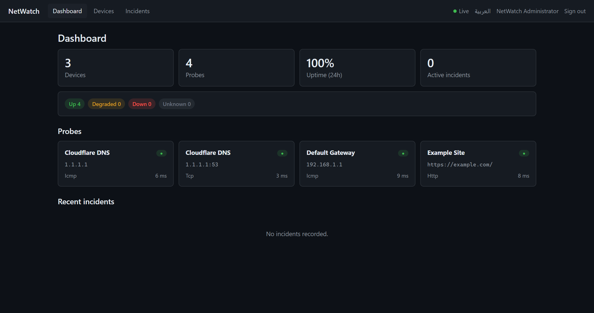
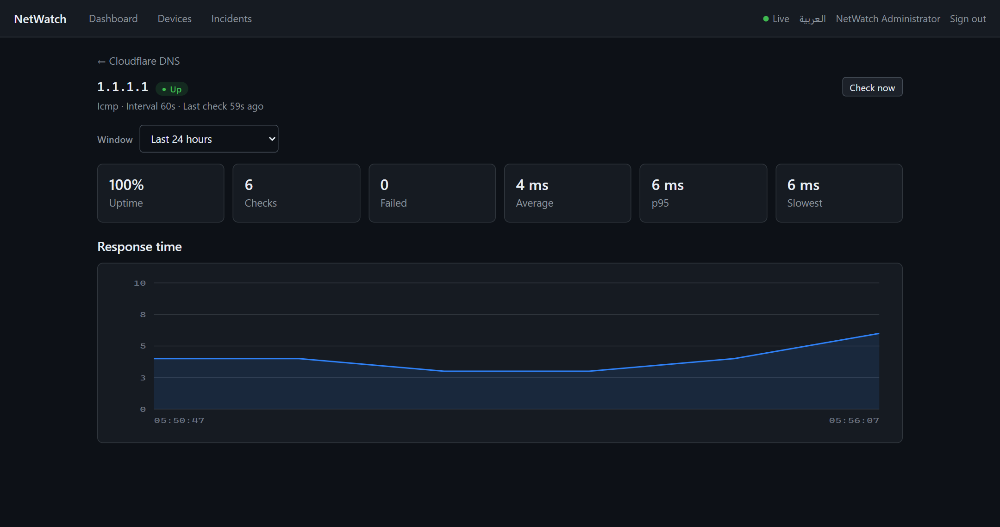
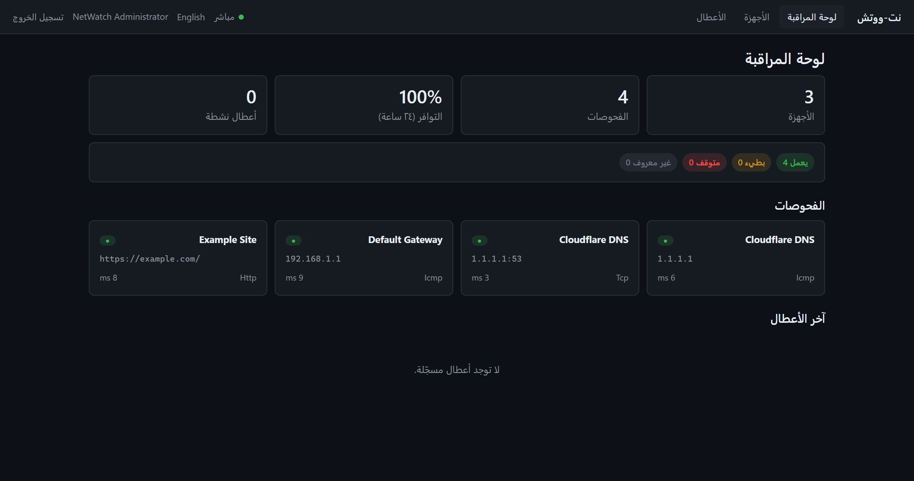

# NetWatch: network and service availability monitoring

[](https://github.com/saeedramadancv-sys/netwatch/actions/workflows/ci.yml)

**Live demo:** https://netwatch-rbmr.onrender.com (Render free tier: the first visit after
idle can take up to a minute to wake). Sign-in is required. For a demo login, message me on
[LinkedIn](https://www.linkedin.com/in/saeedramadan-dotnet/), or [run it locally](#run-it-locally).



| Probe detail: uptime and response time | Arabic (RTL) |
|---|---|
|  |  |

*Screenshots from a local run with the seeded sample devices.*

NetWatch is a self-hosted monitoring app. You register devices (routers, servers, websites),
attach probes to them (ICMP ping, TCP connect or HTTP), and watch their health, response
times, uptime and incidents on a dashboard that updates live. It works in English and Arabic.

**Stack:** ASP.NET Core 9 Web API · EF Core 9 (SQLite / SQL Server) · ASP.NET Core
Identity + JWT · SignalR · Redis · Serilog · Angular 19 · xUnit (125 tests) · Karma (19 tests) · Docker ·
GitHub Actions

---

## What I focused on

A lot of monitoring demos poll a URL and print the status code. I wanted this one to behave
more like a real tool, and I left comments in the code wherever a decision wasn't obvious.

- **One lost packet shouldn't wake anyone up.** A probe only goes *Down* after N failures in
  a row, and only comes back *Up* after M successes in a row. That logic lives on the domain
  entity with no I/O, so I could test every transition without a network or a clock.
- **An incident is an outage, not a failed check.** One incident record covers the whole
  outage, from the first failure until it resolves itself. Along the way it can escalate
  from degraded to down, an operator can acknowledge it, and it keeps a running failure count.
- **The scheduler.** A `BackgroundService` on a `PeriodicTimer` (so it doesn't drift), a new
  DI scope for each check (`DbContext` isn't thread-safe), a `SemaphoreSlim` limit on how many
  probes run at once, and a cap on how many start in one tick. A retention job deletes old
  results in small batches.
- **The database is a config switch.** There's no raw SQL and no provider-specific types.
  SQLite is used for development and CI, SQL Server for production. Each provider has its
  own migrations project, because migrations contain engine-specific SQL, and CI fails if
  the model drifts from either one.
- **Security.** Refresh tokens are stored as SHA-256 hashes and replaced on every use, and
  replaying an old one revokes the whole chain. A wrong password and an unknown email get
  exactly the same response. Accounts lock after 5 failed attempts. In Development the app
  generates a temporary signing key; in any other environment it refuses to start without one.
- **Updates are pushed, not polled.** SignalR sends every check result and incident change
  to the browser, and the Angular dashboard updates in place. The connection indicator is
  always visible, so you can tell when the dashboard has gone stale.
- **Arabic is a full language here, not an afterthought.** You can switch between English and
  Arabic at runtime. The app sets `dir` on the document, uses CSS logical properties instead
  of a separate RTL stylesheet, and keeps hostnames and URLs left-to-right inside Arabic text.
  A test checks that both languages have the same translation keys.

## Architecture

```
┌────────────────────┐     REST + SignalR      ┌─────────────────────────────┐
│  Angular 19 SPA    │ ◄─────────────────────► │  NetWatch.Api               │
│  (signals, lazy    │                         │  controllers · JWT · hub    │
│   routes, RTL)     │                         ├─────────────────────────────┤
└────────────────────┘                         │  NetWatch.Application       │
                                               │  services · DTOs · rules    │
        probes                                 ├─────────────────────────────┤
   ICMP / TCP / HTTP  ◄────────────────────────│  NetWatch.Infrastructure    │
        ▲                                      │  EF Core · Identity ·       │
        │                                      │  scheduler · probe engine   │
   monitored network                           ├─────────────────────────────┤
                                               │  NetWatch.Domain            │
                                               │  entities · state machine   │
                                               └─────────────────────────────┘
```

Dependencies only point inward. The domain project has no references, and the probe state
machine and incident lifecycle are plain code with full unit test coverage.

## Run it locally

You need the .NET 9 SDK and Node 22 or newer.

```bash
# API (terminal 1): SQLite, migrations, seed data and a temporary JWT key, no setup needed
cd src/NetWatch.Api
dotnet run --urls http://localhost:5080
```

```bash
# Client (terminal 2)
cd client/netwatch-web
npm install
npm start
```

Open http://localhost:4200 and sign in with the development seed account
`admin@netwatch.local` / `NetWatch#Dev1`. This account only exists in Development: in
production the app won't create an admin unless you give it a password. Swagger lives at http://localhost:5080/swagger.

Three sample devices are seeded, so the dashboard has live data straight away.

### Tests

```bash
dotnet test                                    # 125 backend tests (xUnit)
cd client/netwatch-web && npm test             # 19 client tests
```

## Caching

The dashboard summary is the most expensive read in the app: four repository round trips,
one of them an aggregate over the whole probe-result table. Every open dashboard asks for it
on an interval.

It's also the one read where a stale answer is an actual bug. A monitoring screen that says
"all up" thirty seconds into an outage is worse than no screen. So I don't just rely on a
TTL. `CacheInvalidatingMonitoringNotifier` clears the entry as soon as a probe changes state
or an incident opens or resolves, and the TTL is only there in case an invalidation gets
lost. Checks that don't change anything (which is almost all of them) leave the cache alone.

To invalidate, I rotate a version token that's part of the cache key instead of deleting
keys. `IDistributedCache` can't delete by wildcard, and scanning Redis for matching keys is
something the Redis docs warn against in production. Rotating the token is a single write,
however many windows are cached.

Redis is optional and switched on by its connection string:

```bash
# Without this, an in-process distributed cache is used instead, so a fresh clone
# and the test host don't need Redis installed.
ConnectionStrings__Redis="localhost:6379"
```

`docker-compose.yml` and the Azure template both set it up. With a single instance, the
in-process fallback works fine. It only stops being enough once there's a second replica,
because each one would keep its own cache.

## Deploy to Azure (template, not yet deployed)

The live demo runs on Render (`render.yaml`). The Bicep template and the `Deploy to Azure`
workflow below are written, but I haven't run them against an Azure subscription yet.

`infra/main.bicep` creates an App Service (Linux container), Azure Cache for Redis and Azure
SQL, and puts the connection strings into the app settings. The `Deploy to Azure` workflow
runs the tests, pushes the image to GHCR and applies the template.

```bash
az group create --name netwatch-rg --location westeurope
az deployment group create \
  --resource-group netwatch-rg \
  --template-file infra/main.bicep \
  --parameters appName=<globally-unique-name> \
               sqlAdminLogin=<login> \
               sqlAdminPassword=<password> \
               jwtSigningKey=<base64-key> \
               containerImage=<image:tag>
```

The workflow signs in to Azure with OIDC, so there's no publish profile or service-principal
secret in the repository. It needs `AZURE_CLIENT_ID`, `AZURE_TENANT_ID`,
`AZURE_SUBSCRIPTION_ID`, `SQL_ADMIN_LOGIN`, `SQL_ADMIN_PASSWORD` and `JWT_SIGNING_KEY` as
repository secrets. It only runs when started by hand (`workflow_dispatch`), because a
monitoring system that redeploys on every push to main goes blind during each rollout.

The App Service plan is B1 instead of the free tier because the monitoring
`BackgroundService` needs `alwaysOn`. On a tier that puts the app to sleep, checks would stop
whenever nobody had the dashboard open.

## Run it with Docker

```bash
cp .env.example .env    # fill in JWT_SIGNING_KEY, MSSQL_SA_PASSWORD, ADMIN_PASSWORD
docker compose up --build
```

Compose starts three containers: the API, SQL Server and Redis. The API serves both the
backend and the built Angular app from one origin (so there's no CORS in production), and it
waits until SQL Server and Redis pass their health checks. When it's up, open
http://localhost:8080. ICMP probes need `NET_RAW`, which the compose file grants; TCP and
HTTP probes work without it.

## Roles

| Role | Can |
|---|---|
| **Viewer** | See dashboards, history, incidents |
| **Operator** | + add/edit devices and probes, acknowledge incidents, run checks |
| **Admin** | + delete devices, register users |

The API checks the role on every endpoint. The client just hides buttons the API would
reject anyway.

## Where to look in the code

| Decision | Where |
|---|---|
| Debounce thresholds and state transitions | [`Domain/Entities/Probe.cs`](src/NetWatch.Domain/Entities/Probe.cs) |
| Telling failures apart (refused, timeout, DNS) | [`Infrastructure/Probing/`](src/NetWatch.Infrastructure/Probing) |
| Drift-free scheduling, scope per check, limited concurrency | [`MonitoringSchedulerService.cs`](src/NetWatch.Infrastructure/Monitoring/MonitoringSchedulerService.cs) |
| Refresh-token rotation and what happens on token theft | [`AuthService.cs`](src/NetWatch.Infrastructure/Identity/AuthService.cs) |
| Stopping a refresh stampede in the client | [`auth.interceptor.ts`](client/netwatch-web/src/app/core/interceptors/auth.interceptor.ts) |
| Migrations per provider and the drift check in CI | `NetWatch.Migrations.*` and [`ci.yml`](.github/workflows/ci.yml) |
| p95 vs average, and why a dashboard needs both | [`LatencyStatistics.cs`](src/NetWatch.Application/Monitoring/LatencyStatistics.cs) |
| Event-driven cache invalidation | [`CachedDashboardService.cs`](src/NetWatch.Application/Dashboard/CachedDashboardService.cs) |
| A cache failure makes things slower, never unavailable | [`DistributedCacheService.cs`](src/NetWatch.Infrastructure/Caching/DistributedCacheService.cs) |
| RTL with logical properties, hostnames kept LTR | [`styles.scss`](client/netwatch-web/src/styles.scss), `i18n.service.ts` |

## Known trade-offs

- Tokens are kept in `localStorage` so the app survives a page refresh. Since production
  serves everything from one origin, it could move to HttpOnly cookies with CSRF protection.
- The SignalR hub sends updates to every signed-in client. At a bigger scale, the next step
  would be groups (for example, one per site).
- Percentiles are worked out from the charted sample, not the full time window. That's noted
  on the DTO, and I did it on purpose so the query works the same on both databases.

## License

MIT
